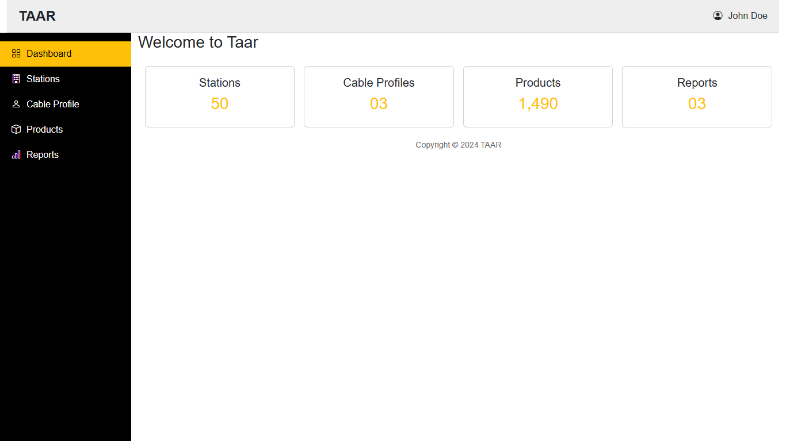
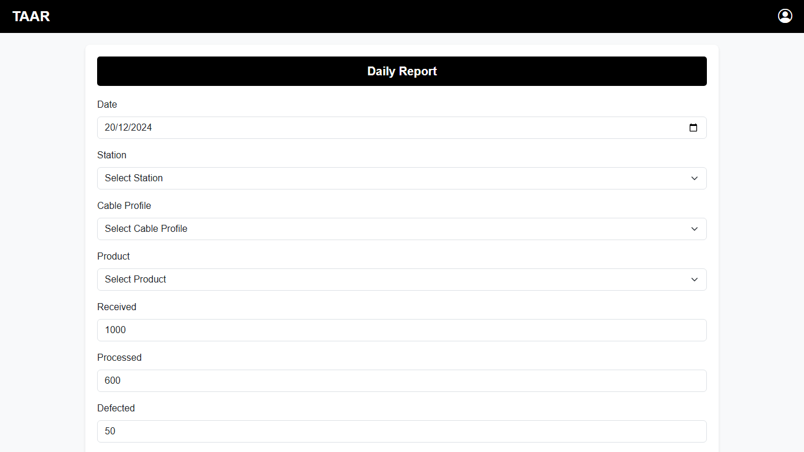
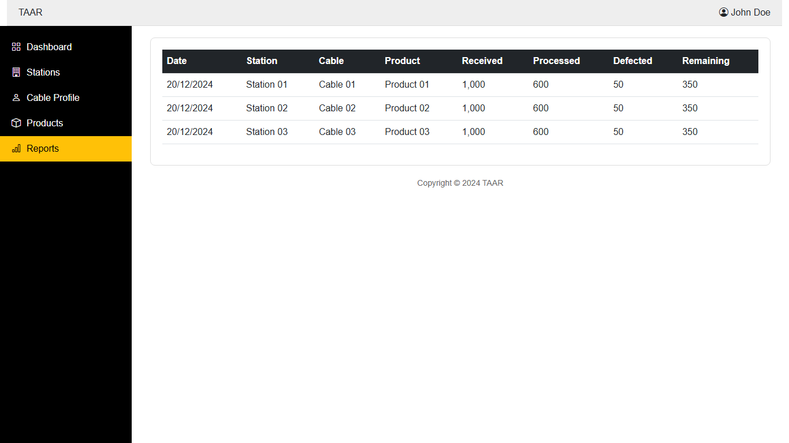

# TAAR – Production Reporting Dashboard

A responsive admin panel and staff reporting app for tracking daily production at a cable factory: which **station** processed which **cable profile** and **product**, and how many units were received, processed and found defective.

Built as a front-end prototype with **HTML, CSS and Bootstrap 5**. No build step is needed.



## Features

**Admin panel** (`admin/`)
- **Login** and **change password** screens
- **Dashboard** with totals for stations, cable profiles, products and reports
- **Stations, Cable Profiles and Products**: list, add, edit and delete
- **Reports**: one table showing date, station, cable, product, and received / processed / defected / remaining counts

**Staff app** (`user/`)
- **Login** for factory staff
- **Daily Report** form: pick the date, station, cable profile and product, then enter received, processed and defected counts
- **Thank-you** confirmation after the report is sent

| Daily report (staff) | Reports (admin) |
|---|---|
|  |  |

## Tech stack

- HTML5 and CSS3
- [Bootstrap 5](https://getbootstrap.com/) for layout and components
- [Bootstrap Icons](https://icons.getbootstrap.com/)

## Run it locally

```bash
git clone https://github.com/hamzaibrahim03/tarr.git
cd tarr
```

Then open `admin/login.html` (admin panel) or `user/user_login.html` (staff app) in your browser. Bootstrap loads from a CDN, so you need an internet connection.

## Project structure

```
admin/
  login.html            Admin login
  dashboard.html        Overview with totals
  station.html          Stations list       → new_station.html
  cable.html            Cable profiles list → new_cable.html
  products.html         Products list       → new_product.html
  reports.html          Production reports
  change_password.html
user/
  user_login.html       Staff login
  daily_reports.html    Daily production report form
  thank_you.html        Confirmation page
screenshots/            Images used in this README
```

## Status

This is a **UI prototype**: the pages use sample data and the forms don't save anywhere yet. The next step is connecting them to a back end (for example Laravel or Node.js with a database) so reports are stored and the dashboard totals are calculated from real data.

## Author

**Hamza Ibrahim** – [GitHub](https://github.com/hamzaibrahim03)
